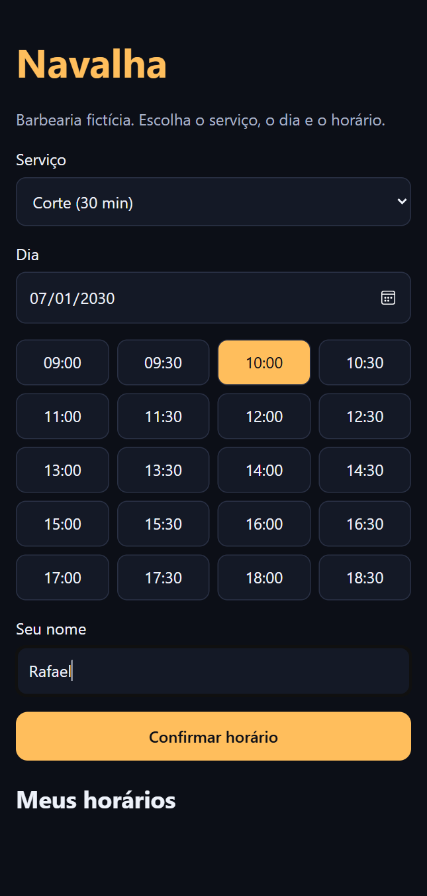
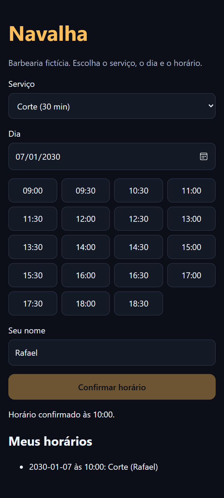

# Agendamento online para barbearia

Página de agendamento em que o cliente escolhe serviço, dia e horário em poucos toques, direto do celular.

  

**Demonstração:** https://luizrenatodc.github.io/agenda-barbearia-web/

## Veja funcionando

<p align="center"> </p>

## O problema

Em uma barbearia, o barbeiro está com as mãos ocupadas e não consegue responder mensagem para marcar horário. O cliente quer ver o que está livre e confirmar na hora, sem instalar nada.

## O que ela faz

- Mostra só os horários em que o serviço escolhido cabe por inteiro.
- Bloqueia horários já reservados e fecha aos domingos.
- Libera a confirmação apenas com horário e nome preenchidos.
- Guarda as reservas no navegador e lista os horários marcados.

## Como funciona

As regras ficam em `regras.js`, sem nenhum acesso à tela. A interface em `app.js` só chama essas funções e desenha o resultado, o que permite testar a lógica sem navegador.

```text
regras.js        horários livres e serviços (funções puras)
app.js           interface e localStorage
regras.test.js   testes
```

## Decisões técnicas

| Decisão | Motivo |
| --- | --- |
| JavaScript puro | A página abre rápido em celular simples, sem etapa de build. |
| Regras separadas da interface | A parte que pode dar errado fica coberta por testes. |
| `localStorage` | Basta para a demonstração. Em produção, as reservas iriam para uma API como a [agenda-api](https://github.com/luizrenatodc/agenda-api). |

## Como rodar

```bash
npm test
npx serve .
```

## Próximos passos

- Conectar à API para compartilhar a agenda entre clientes.
- Escolher o barbeiro.
- Confirmar o horário por WhatsApp.

## Sobre este projeto

Projeto de demonstração, com dados e empresas fictícios, criado para mostrar a abordagem técnica de forma simples.

## Autor

**Luiz Renato Carvalho**, Engenheiro de Software e IA · [luizrenato.dev](https://www.luizrenato.dev) · [LinkedIn](https://linkedin.com/in/luizrenatodc)
